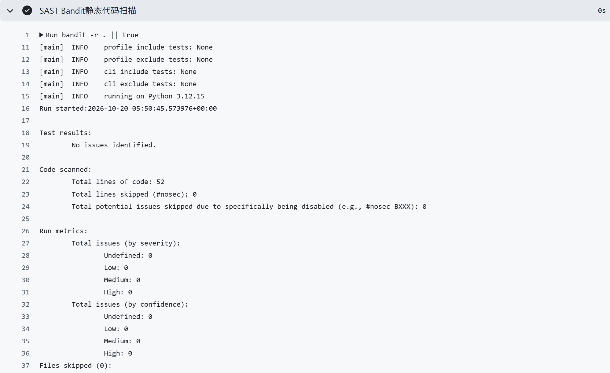
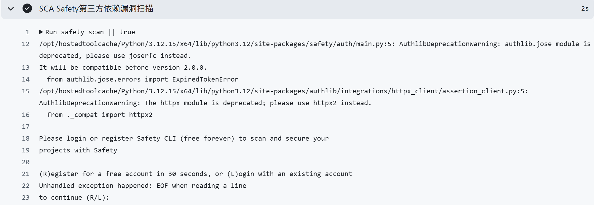
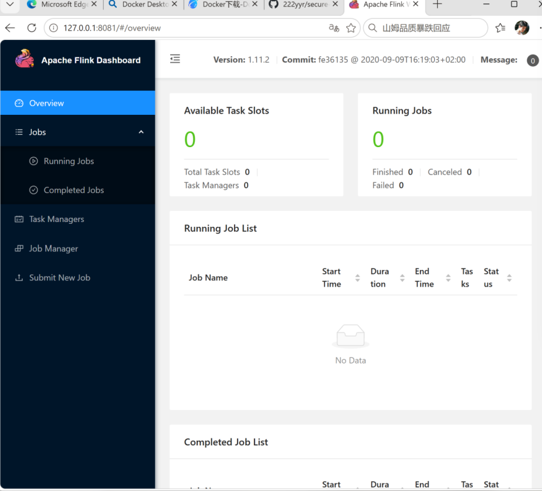
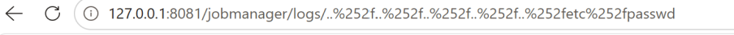
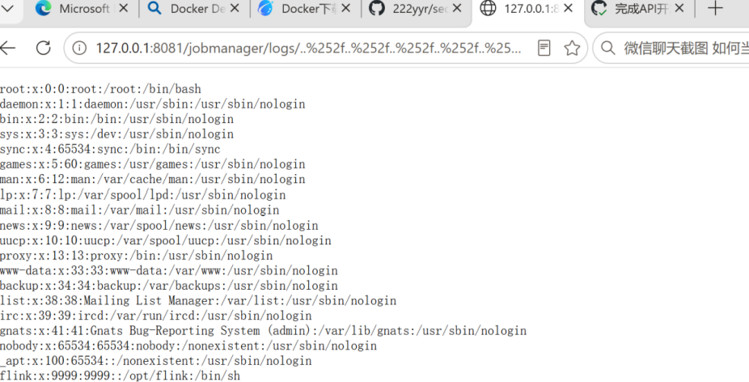
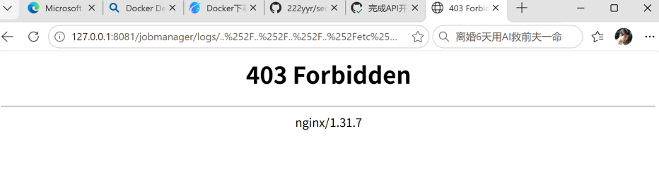
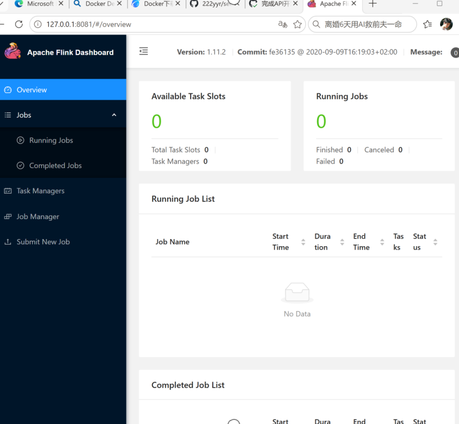

# Secure RESTful API, CI/CD Security Scanning and Vulnerability Remediation Project

##  1. Project and API Description
This project builds a secure REST API based on Flask. It adopts SQLite as the database, SQLAlchemy ORM for database operations, JWT for identity authentication, and bcrypt for password hashing.

Available API endpoints and calling methods:
1. `POST /auth/login`
    - Function: User login to obtain a JWT access token
    - Request Header: `Content-Type: application/json`
    - Request Body:
    {
      "username": "admin",
      "password": "123456"
    }
    - Response: Return `access_token` if authentication succeeds; return 401 error if username or password is wrong.

2. `GET /api/data`
    - Function: Get sample data, integrated with XSS escape protection
    - Request Header: `Authorization: Bearer <access_token>`
    - Note: A valid JWT token is mandatory, otherwise access will be denied.

3. `GET /api/profile`
    - Function: Query profile information of the currently authenticated user
    - Request Header: `Authorization: Bearer <access_token>`
    - Note: Requires a valid JWT token.

Calling workflow:
1. Send a POST request to `/auth/login` with the correct username and password to get the JWT token.
2. Add the token to the `Authorization` header for accessing protected endpoints `/api/data` and `/api/profile`.
3. The backend will verify the validity of the JWT token before returning the requested resource.
## 2. Implemented Security Measures
This lab demonstrates directory traversal protection with Nginx reverse proxy. Below are general security controls for SQL injection, XSS and authentication:
- **Protection against SQL Injection**: Use prepared statements / parameterized queries. Avoid concatenating user input directly into raw SQL statements. Use ORM libraries to escape special characters automatically.
- **Protection against XSS**: Sanitize user input before storage. Encode output when rendering user-controlled content on HTML pages. Deploy Content-Security-Policy (CSP) headers to block unauthorized scripts.
- **Authentication**: Verify user identity with secure session cookies or JWT tokens. Enforce access control checks before serving protected resources.

In this experiment: An Nginx reverse proxy is placed in front of Flink. Nginx rules block requests containing directory traversal patterns before traffic reaches Flink.

## 3. SAST / SCA Report Screenshot

## 4. Vulnerability Information
CVE ID: **CVE-2020-17519**
Brief description: Apache Flink versions 1.11.0 to 1.11.2 contain a directory traversal vulnerability at the `/jobmanager/logs/` endpoint. Attackers can use double URL encoded `../` payloads to escape the log directory and read arbitrary local files on the server.

## 5. Steps to Reproduce the Vulnerability
1. Start the vulnerable environment:
`docker-compose up -d`
2.Send malicious request to trigger directory traversal:
[http://127.0.0.1:8081/jobmanager/logs/..%252F..%252F..%252Fetc%252Fpasswd](http://127.0.0.1:8081/jobmanager/logs/..%252F..%252F..%252Fetc%252Fpasswd)
3.Observe the response: the server returns content of /etc/passwd, proving the vulnerability exists.

## 6. Root Cause Analysis
The Flink backend did not fully validate and sanitize the user-supplied path parameter. The developers only filtered simple ../ strings. Attackers bypass this filter using double URL encoding of ../. The decoded path escapes the log folder boundary, allowing access to files anywhere on the host filesystem.

## 7. Description of the Applied Fix
Changes made:
Modified docker-compose.yml: added an Nginx service as reverse proxy in front of Flink.
Created nginx.conf: added custom rules to detect and block HTTP requests with directory traversal patterns such as ../ and encoded traversal payloads.
Why it works: All incoming requests must pass through Nginx first. Malicious traversal payloads are blocked at the proxy layer before reaching the vulnerable Flink service. This prevents the attack from reaching the unsafe API endpoint.

## 8. Proof of Vulnerability Elimination
Start the fixed environment with the updated docker-compose configuration. Run the same curl payload as before. Nginx rejects the malicious request, and the attack cannot read system files. This proves the vulnerability has been mitigated.

